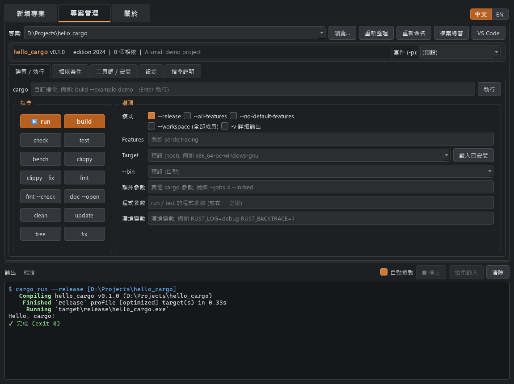
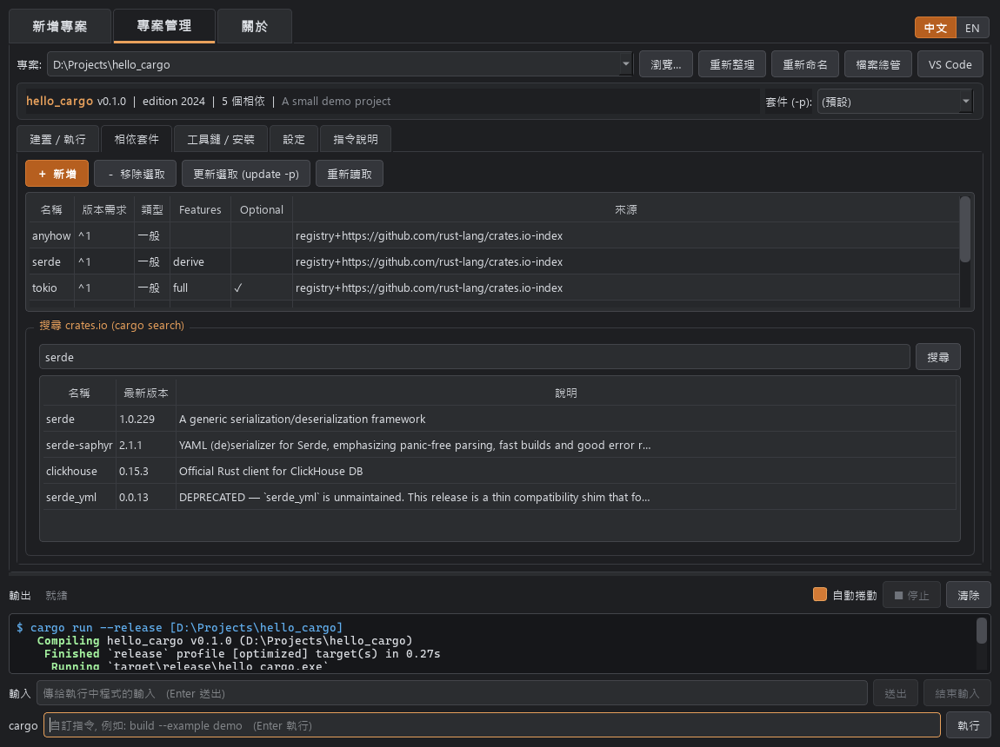
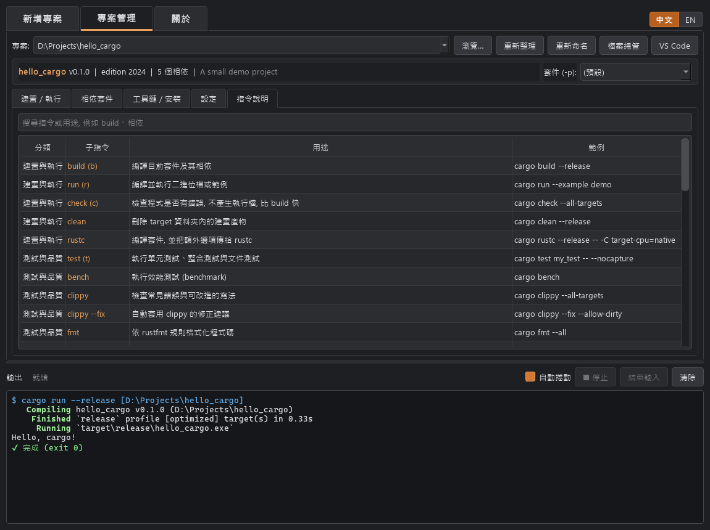
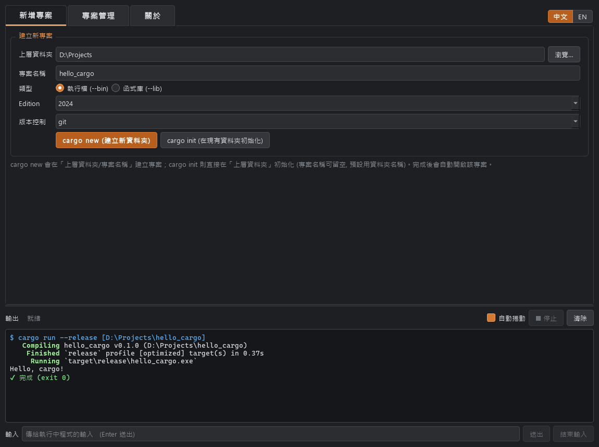
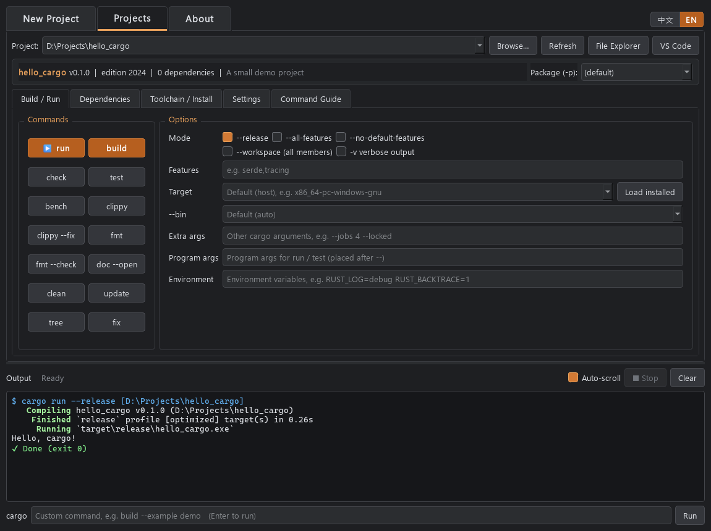
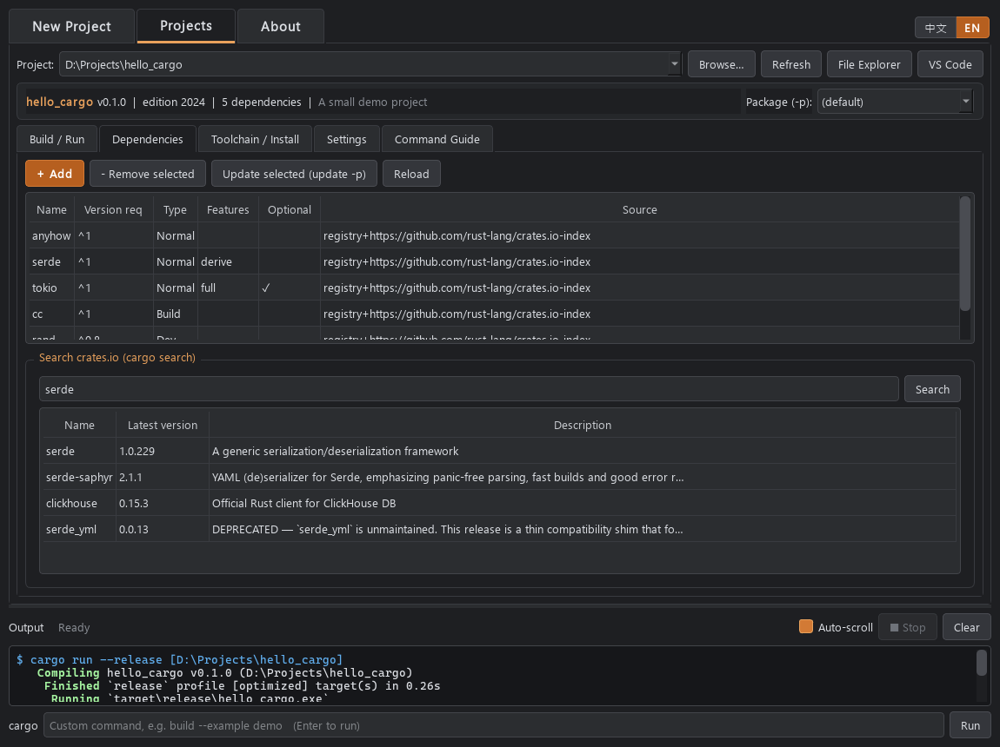
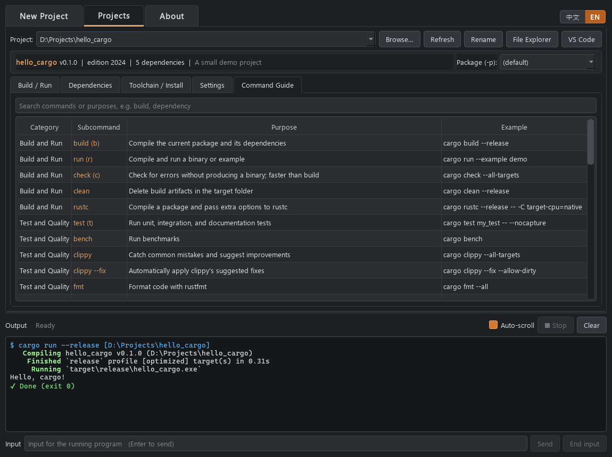
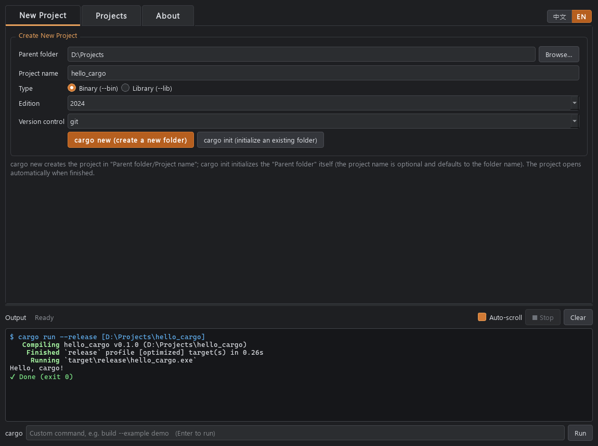

# Cargo Manager

[繁體中文](#繁體中文) | [English](#english)

---

## 繁體中文

Cargo Manager 是 Rust cargo 的深色模式圖形化管理工具，以 Python 與 PySide6 開發，可以在同一個視窗中建立專案、建置執行，以及管理相依套件與工具鏈。

### 功能

- **新增專案**：`cargo new` / `cargo init`，可選 bin 或 lib、edition 2015–2024、版本控制系統。
- **建置 / 執行**：`run`、`build`、`check`、`test`、`bench`、`clippy`、`fmt`、`doc`、`clean`、`update`、`tree`、`fix`，並可設定 release、features、target、`--bin`、額外參數、程式參數與環境變數。
- **相依套件**：列出目前相依，`cargo add` / `remove` / `update -p`，搜尋 crates.io 後雙擊加入。
- **工具鏈 / 安裝**：`rustup` 的 show、update、toolchain、target、component、default、override，以及 `cargo install` / `uninstall`。
- **指令說明**：可搜尋的 cargo 指令用途與範例。
- **輸出區**：顯示 cargo 彩色輸出、自動捲動、停止執行中的指令，也能輸入自訂 cargo 指令。
- **專案管理**：最近 15 個專案、支援 workspace 成員選擇，可開啟檔案總管或 VS Code。
- **介面語系**：在視窗右上角切換繁體中文 / English，立即生效。

### 畫面截圖

**建置 / 執行**



**相依套件**



**指令說明**



**新增專案**



### 系統需求

- Windows（主要平台），Linux 也可執行
- Python 3.10 以上
- PySide6
- [Rust](https://rustup.rs/)（rustup / cargo）

### 安裝與執行

```bash
python -m venv .venv
.venv\Scripts\activate
pip install PySide6
python cargo_manager.py
```

Linux 請改用 `source .venv/bin/activate` 啟用虛擬環境。

### 打包成執行檔

```bash
pip install pyinstaller
pyinstaller -D -w --name cargo_manager --icon logo/cargo_manager.ico --add-data "logo:logo" cargo_manager.py
```

`logo` 資料夾會自動放進 `dist/cargo_manager/_internal/`，不需要手動複製。

### 設定檔

設定會存在程式同目錄的 `cargo_manager.json`，包含工具路徑、最近專案、介面語系與視窗位置。

### 授權

本專案採用 [MIT 授權](LICENSE)。

### 作者

DeanLin

---

## English

Cargo Manager is a dark-mode desktop GUI for Rust's cargo, built with Python and PySide6. It lets you create projects, build and run them, and manage dependencies and toolchains from one window.

### Features

- **New Project**: `cargo new` / `cargo init` with bin or lib, editions 2015–2024, and a choice of version control system.
- **Build / Run**: `run`, `build`, `check`, `test`, `bench`, `clippy`, `fmt`, `doc`, `clean`, `update`, `tree`, and `fix`, with options for release, features, target, `--bin`, extra arguments, program arguments, and environment variables.
- **Dependencies**: View current dependencies, run `cargo add` / `remove` / `update -p`, and search crates.io, then double-click a result to add it.
- **Toolchain / Install**: `rustup` show, update, toolchain, target, component, default, and override, plus `cargo install` / `uninstall`.
- **Command Guide**: A searchable reference of cargo commands with their purposes and examples.
- **Output panel**: Shows cargo's colored output, auto-scrolls, stops running commands, and accepts custom cargo commands.
- **Project management**: Remembers the 15 most recent projects, supports selecting workspace members, and opens projects in File Explorer or VS Code.
- **Interface language**: Switch between Traditional Chinese and English from the top-right corner; the change applies immediately.

### Screenshots

**Build / Run**



**Dependencies**



**Command Guide**



**New Project**



### Requirements

- Windows (primary platform); also runs on Linux
- Python 3.10 or later
- PySide6
- [Rust](https://rustup.rs/) (rustup / cargo)

### Install and Run

```bash
python -m venv .venv
.venv\Scripts\activate
pip install PySide6
python cargo_manager.py
```

On Linux, activate the virtual environment with `source .venv/bin/activate` instead.

### Build an Executable

```bash
pip install pyinstaller
pyinstaller -D -w --name cargo_manager --icon logo/cargo_manager.ico --add-data "logo:logo" cargo_manager.py
```

The `logo` folder is placed in `dist/cargo_manager/_internal/` automatically, so there is no need to copy it by hand.

### Configuration

Settings are stored in `cargo_manager.json` next to the program, including tool paths, recent projects, the interface language, and the window position.

### License

This project is licensed under the [MIT License](LICENSE).

### Author

DeanLin
